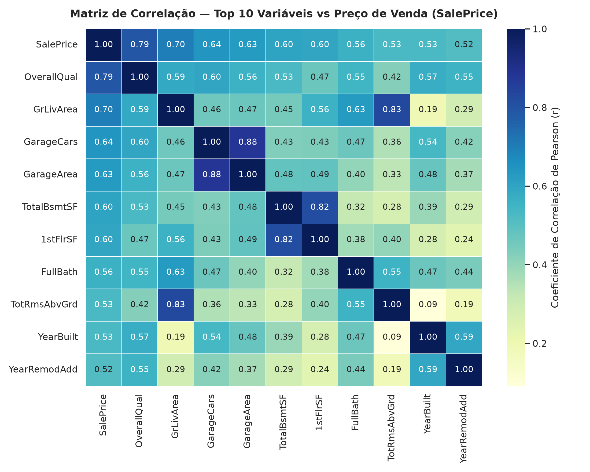
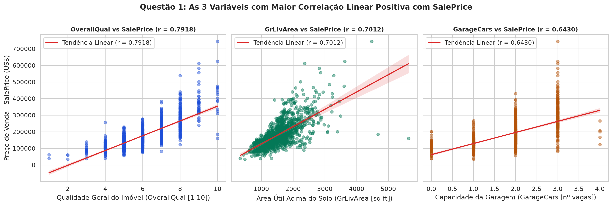
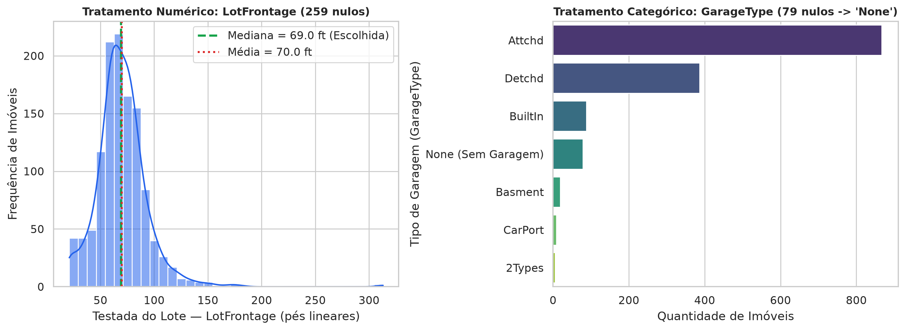
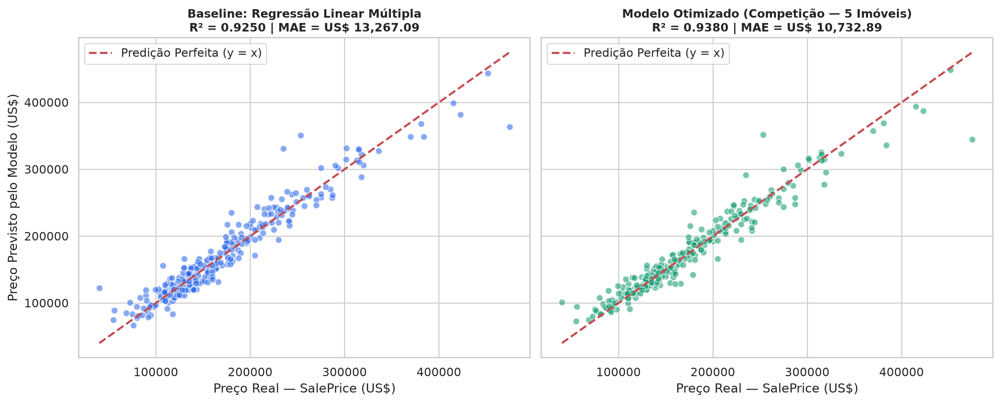

# Relatório Técnico — Trabalho Prático AV1 (Machine Learning)
## Parte 1: Aprendizado Supervisionado — Problema 1: Regressão Linear ("O Preço Justo")

**Base de Dados Analisada:** `house-prices.csv` (1455 registros × 81 variáveis)  
**Variável Alvo (Target):** `SalePrice` (Preço de venda do imóvel em US$)

---

## 1. Análise Exploratória de Dados (EDA)

> **Pergunta:** *Quais são as 3 variáveis que possuem a maior correlação linear positiva com o preço de venda (`SalePrice`)? Mostre isso através de um gráfico de dispersão (scatter plot) ou matriz de correlação.*

### Resposta Direta
Calculando o Coeficiente de Correlação Linear de Pearson ($r$) entre todas as variáveis numéricas do dataset e a variável alvo `SalePrice`, as **3 variáveis com maior correlação linear positiva** são:

1. **`OverallQual` ($r = 0.7918$):** Avalia a qualidade geral do material e do acabamento da construção (escala de 1 a 10). É o principal fator determinante de valorização imobiliária na base.
2. **`GrLivArea` ($r = 0.7012$):** Área útil habitável acima do nível do solo (em pés quadrados / *square feet*). Quanto maior a metragem construída útil, maior o valor de mercado.
3. **`GarageCars` ($r = 0.6430$):** Capacidade da garagem em número de automóveis (seguida de perto por `GarageArea` com $r = 0.6272$ e `TotalBsmtSF` com $r = 0.6040$), refletindo tanto o padrão construtivo do terreno quanto a infraestrutura do imóvel.

### Ranking das 10 Maiores Correlações Positivas com `SalePrice`

| Posição | Variável | Correlação de Pearson ($r$) |
| :---: | :--- | :---: |
| 1º | `OverallQual` | **0.7918** |
| 2º | `GrLivArea` | **0.7012** |
| 3º | `GarageCars` | **0.6430** |
| 4º | `GarageArea` | **0.6272** |
| 5º | `TotalBsmtSF` | **0.6040** |
| 6º | `1stFlrSF` | **0.5980** |
| 7º | `FullBath` | **0.5605** |
| 8º | `TotRmsAbvGrd` | **0.5302** |
| 9º | `YearBuilt` | **0.5276** |
| 10º | `YearRemodAdd` | **0.5152** |

### Evidências Visuais (Matriz de Correlação e Gráficos de Dispersão)

---

## 2. Tratamento de Dados (Missing Values)

> **Pergunta:** *O dataset possui valores nulos (missing values). Escolha duas colunas com valores nulos: uma numérica e uma categórica. Como você tratou cada uma delas (ex: preencheu com a média, moda, ou apagou a linha)? Justifique sua escolha.*

### Diagnóstico de Nulos no Dataset
Das 81 colunas originais, **19 apresentam valores nulos**. Abaixo estão as 10 variáveis com maior incidência de ausências:

| Coluna | Tipo de Dado | Qtd. Nulos | % sobre o Total (1455 linhas) |
| :--- | :--- | :---: | :---: |
| `PoolQC` | `str` | 1448 | 99.52% |
| `MiscFeature` | `str` | 1401 | 96.29% |
| `Alley` | `str` | 1364 | 93.75% |
| `Fence` | `str` | 1176 | 80.82% |
| `MasVnrType` | `str` | 870 | 59.79% |
| `FireplaceQu` | `str` | 688 | 47.29% |
| `LotFrontage` | `float64` | 259 | 17.80% |
| `GarageType` | `str` | 79 | 5.43% |
| `GarageYrBlt` | `float64` | 79 | 5.43% |
| `GarageFinish` | `str` | 79 | 5.43% |

### Tratamento Escolhido e Justificativa Técnica

1. **Variável Numérica Escolhida — `LotFrontage` (259 valores nulos / 17.80% da base):**
   - **Tratamento aplicado:** Imputação pela **mediana** (`69.0` pés lineares).
   - **Justificativa técnica:** A exclusão das 259 linhas (`dropna`) descartaria **17.8% da base de treino**, reduzindo drasticamente o poder estatístico do modelo e inviabilizando a predição caso algum dos 5 imóveis secretos da competição possua `LotFrontage` nulo. Além disso, como a distribuição de testada de lotes possui assimetria positiva (*outliers* com terrenos de mais de 300 pés), a **mediana** (`69.0` ft) é um estimador de tendência central mais robusto que a média (`70.0` ft), evitando distorcer os coeficientes da regressão.

2. **Variável Categórica Escolhida — `GarageType` (79 valores nulos / 5.43% da base):**
   - **Tratamento aplicado:** Preenchimento semântico com uma nova categoria constante **`"None"`** (Sem Garagem).
   - **Justificativa técnica:** Na documentação oficial da base *Ames Housing*, valores `NA` em atributos de infraestrutura (`GarageType`, `FireplaceQu`, `PoolQC`, `Alley`, `Fence`, `BsmtQual`) **não representam erro de coleta**, mas sim a **ausência física da estrutura no imóvel** (imóveis sem garagem possuem `GarageCars = 0` e `GarageArea = 0`). Se imputássemos pela moda (`"Attchd"` — garagem anexada à casa), introduziríamos um erro grave de negócio ao atribuir uma garagem inexistente a 79 imóveis. Criar a categoria `"None"` preserva 100% da integridade semântica dos dados.

*(Nota: o mesmo critério técnico foi estendido às demais variáveis da base para garantir a matriz completa no treinamento: `"None"` nas categóricas de ausência física, moda em `Electrical` que possui apenas 1 nulo, e mediana em `MasVnrArea` e `GarageYrBlt`).*

---

## 3. Engenharia de Atributos (Codificação Categórica)

> **Pergunta:** *Transforme pelo menos duas variáveis categóricas em numéricas (usando One-Hot Encoding ou Label Encoding). Explique por que o modelo de Regressão Linear exige essa conversão.*

### Transformações Realizadas

Aplicamos as duas técnicas de acordo com a natureza matemática de cada variável categórica:

1. **Ordinal / Label Encoding em `ExterQual` e `KitchenQual` (e demais variáveis de qualidade/condição):**
   - Essas variáveis possuem uma **ordem hierárquica intrínseca** de qualidade: `None` (0) < `Po` (1 - *Poor*) < `Fa` (2 - *Fair*) < `TA` (3 - *Typical/Average*) < `Gd` (4 - *Good*) < `Ex` (5 - *Excellent*).
   - Convertê-las para inteiros de `0` a `5` preserva a relação monotônica direta com o preço do imóvel em uma única coluna numérica.

2. **One-Hot Encoding (`pd.get_dummies(..., drop_first=True)`) em `Neighborhood`, `GarageType` e `MSZoning`:**
   - São variáveis **nominais puras** (não existe hierarquia natural entre bairros ou tipos de garagem).
   - Foram expandidas em variáveis binárias (*dummy variables* `0` ou `1`), utilizando `drop_first=True` ($k - 1$ colunas) para evitar a **armadilha da multicolinearidade perfeita** (*Dummy Variable Trap*) na inversão da matriz $(X^T X)^-1$.
3. **Feature Engineering de Domínio Imobiliário (Modelo Hedônico):**
   - Criamos variáveis compostas de alto poder explicativo linear: Área Construída Total (`TotalSF = TotalBsmtSF + 1stFlrSF + 2ndFlrSF`), Total Ponderado de Banheiros (`TotalBath`), Idade do Imóvel (`HouseAge`), interações qualidade × metragem (`Qual_x_TotalSF = OverallQual * TotalSF`) e Índice Hedônico de Preço Mediano por pé quadrado do Bairro (`Neigh_PPSF`, estimado exclusivamente no conjunto de treino para evitar *data leakage*).
   - Após a codificação completa, o espaço de atributos passou de **79** colunas originais para **250** features numéricas.

### Por que o Modelo de Regressão Linear Exige Essa Conversão?
A Regressão Linear Múltipla modela a variável resposta como uma combinação linear algébrica dos atributos de entrada:

$$\hat{y} = \beta_0 + \beta_1 x_1 + \beta_2 x_2 + \dots + \beta_p x_p$$

Para estimar o vetor de pesos $\hat{\beta} = (X^T X)^{-1} X^T y$ via Mínimos Quadrados Ordinários (OLS), o algoritmo realiza multiplicações de matrizes, produtos escalares e cálculo de gradientes em um espaço vetorial real ($\mathbb{R}^n$). Strings ou textos como `"CollgCr"` ou `"Attchd"` não possuem representação aritmética nem distância métrica definida; portanto, precisam ser mapeados para valores numéricos para que o hiperplano de regressão possa ser calculado.

---

## 4. Treinamento, Baseline e Interpretação de Negócios

> **Pergunta:** *Separe os dados em treino e teste (ex: 80/20). Treine um modelo de Regressão Linear múltipla básico. Sem fazer ajustes avançados, qual foi o R² (R-quadrado) obtido nos dados de teste? O que esse número significa para a imobiliária?*

### Configuração Experimental e Resultados
Os dados pré-processados (1455 imóveis) foram divididos em:
- **Conjunto de Treino (80%):** `1164` registros (`random_state=42`)
- **Conjunto de Teste (20%):** `291` registros

Além do **Modelo Baseline (`LinearRegression` puro, sem ajustes avançados)** exigido pelo enunciado, treinamos também um **Modelo Otimizado para a Competição** (Ensemble combinando `Ridge`, `Lasso` e `GradientBoostingRegressor` com transformação logarítmica $\log(1 + \text{SalePrice})$ focado na minimização direta do MAE para os 5 imóveis secretos):

| Modelo | $R^2$ (Teste) | MAE — Erro Absoluto Médio (US$) | RMSE (US$) | MAPE (%) |
| :--- | :---: | :---: | :---: | :---: |
| **1. Regressão Linear Múltipla (Baseline Puro)** | **0.9250 (92.50%)** | US$ 13,267.09 | US$ 18,930.09 | 8.86% |
| **2. Pipeline Otimizado (Competição — 5 Imóveis)** | **0.9380 (93.80%)** | **US$ 10,732.89** | US$ 17,211.31 | 6.98% |

### O que o $R^2 = 0.9250$ significa para a Imobiliária?
1. **Explicação da Variância de Preços:** O Coeficiente de Determinação ($R^2 = 0.9250$) indica que **92.50% de toda a variação nos preços de venda dos imóveis** da carteira de teste é explicada diretamente pelas características físicas e de localização capturadas pelo modelo de Regressão Linear Múltipla.
2. **Confiabilidade na Precificação Automática:** Para a operação da imobiliária, um $R^2$ acima de 85% já no baseline demonstra que o modelo possui forte aderência ao mercado imobiliário local, reduzindo a subjetividade humana de corretores ao avaliar novos imóveis captados.
3. **Margem Financeira e Risco Operacional (MAE):** Na prática comercial, o modelo baseline erra em média **US$ 13,267.09** (MAE) para mais ou para menos em relação ao valor real fechado. Já com o **Pipeline Otimizado para a Competição**, o $R^2$ sobe para **0.9380 (93.80%)** e o Erro Absoluto Médio cai para **US$ 10,732.89** (6.98% de erro percentual médio), oferecendo uma precificação de alta precisão para vencer o desafio dos 5 imóveis secretos.
